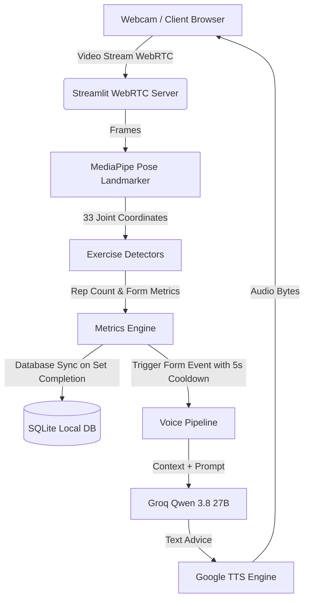

# 🏋️‍♂️ GymGuru AI: Real-Time Pose Detection & AI Voice Coach

GymGuru AI is a web-based, real-time fitness companion built with **Python 3.12**, **MediaPipe**, **Streamlit-WebRTC**, and **Groq Cloud LLM**. It utilizes computer vision to analyze your workouts through your webcam, counts your reps and sets, checks your exercise posture/form, and provides proactive voice corrections in real-time.

---

## 📺 Project Demo Video / Interface Screenshot

> [!TIP]
> *Add your demo video file or screenshot below by replacing the placeholder:*

<!-- REPLACE THIS LINE WITH YOUR DEMO VIDEO/IMAGE LINK -->
```
                   [ PLACE YOUR DEMO VIDEO / IMAGE HERE ]
    (e.g., )
```

---

## 🚀 Key Features

* **Real-Time Pose Tracking**: Leverages MediaPipe's high-performance pose landmark model to track 33 body coordinates in real time.
* **Proactive Voice Coaching**: Powered by **Groq's Qwen-27B LLM** (`qwen/qwen3.8-27b`) and **Google Text-to-Speech (gTTS)**, the coach speaks out loud to correct your form, motivate you, and celebrate set completions.
* **Smart Posture Checking**: Instantly detects specific joint alignments, hip sagging, back arching, elbow drifts, and balance status across 7 exercises.
* **Dual Workout Modes**: Supports **Single Exercise** training and custom sequential **Circuit Mode** with auto-advancing exercise queues.
* **Workout History Tracker**: Automatically logs your performance (sets, reps, active time) to a local SQLite database and displays a visual history summary with KPIs, volume bar charts, and daily activity trends.
* **Seamless Streaming**: Powered by `streamlit-webrtc` with STUN/TURN traversal to support smooth web-based video processing with low latency.
* **Modern Dark UI**: Features customized styling, custom font layouts, and responsive panels for clean visuals.

---

## 🏗️ System Architecture

This diagram shows how video frames flow from your webcam to the pose analyzer and then trigger the AI Voice Coach:



---

## 🏃 Supported Exercises & Form Corrections

| Exercise | Monitored Joints / Landmarks | Form Issues Checked & Corrected |
| :--- | :--- | :--- |
| **Squats** | Hips, Knees, Ankles, Shoulders | Shallow squat depth, excessive forward torso lean |
| **Push-ups** | Elbows, Shoulders, Hips, Ankles | Body misalignment ("Poor Form"), hip sagging, piked-up hips |
| **Bicep Curls** | Shoulders, Elbows, Wrists, Torso | Torso swinging/momentum cheating, elbow drifting from the sides |
| **Shoulder Press** | Shoulders, Elbows, Wrists, Lower Back | Incomplete overhead arm extension, excessive lower back arching |
| **Lunges** | Hips, Knees, Ankles, Shoulders | Loss of balance / lateral sway, improper knee flexion |
| **Planks** | Shoulders, Hips, Ankles | Body misalignment, sagging or piked hips (accumulates active hold seconds) |
| **Jumping Jacks** | Shoulders, Wrists, Hips, Ankles | Stance ratio too narrow during extension, arms not raised above shoulders |

---

## 🛠️ Tech Stack

* **Frontend & Web Server**: Streamlit, HTML5, Custom CSS
* **Computer Vision**: MediaPipe (`pose_landmarker_full.task`), OpenCV (Headless)
* **AI Intelligence**: Groq API (`qwen/qwen3.8-27b` model)
* **Speech Processing**: Google Text-to-Speech (`gtts`)
* **Streaming & Networking**: `streamlit-webrtc`, aiortc, STUN/TURN servers
* **Database**: SQLite3, Pandas
* **Environment**: Python 3.12 (Required for MediaPipe Windows compatibility), `python-dotenv`

---

## ⚙️ Getting Started & Local Setup

### Prerequisites
* **Python 3.12** is required.
  > [!IMPORTANT]
  > **Use Python 3.12**. `mediapipe` does not currently support Python 3.13 on Windows.
* Package manager: `uv` (recommended) or `pip`.

### 1. Clone the Repository
```bash
git clone https://github.com/HariomGupta0/AI_Gym_Buddy.git
cd AI_Gym_Buddy
```

### 2. Configure Environment Variables
Create a `.env` file in the root directory:
```env
GROQ_API_KEY=your_groq_api_key_here
```
*(Your `.env` file is protected locally and ignored by Git automatically).*

### 3. Create a Virtual Environment & Install Dependencies

**Using `uv` (Recommended):**
```powershell
# Create environment explicitly targeting Python 3.12
uv venv --python "C:\Users\<username>\AppData\Local\Programs\Python\Python312\python.exe" .venv

# Install dependencies
uv pip install -r requirements.txt
```

**Using Standard Virtualenv:**
```powershell
# Create venv with Python 3.12
py -3.12 -m venv .venv

# Activate the virtual environment
.\.venv\Scripts\Activate.ps1

# Install requirements
pip install -r requirements.txt
```

---

## 🚦 Running the Application

Launch the app directly through your virtual environment:

```powershell
# Directly using the venv python executable:
.\.venv\Scripts\python.exe -m streamlit run main.py

# Or if the environment is activated (.venv):
python -m streamlit run main.py
```

Open `http://localhost:8501` in your web browser, enter a username, select your exercise plan, and start training!

---

## 📂 Project Structure

```
├── core/
│   └── base_exercise.py          # Abstract base class for workout detectors & angle math
├── detectors/
│   ├── biceps_curls.py           # Biceps curls angle & drift analysis
│   ├── jumping_jacks.py          # Jumping jacks stance ratio & arm extension logic
│   ├── lunges.py                 # Lunges knee flexion & balance analysis
│   ├── plank.py                  # Plank body alignment & active hold timer
│   ├── pushup.py                 # Push-up elbow angle & hip sag analysis
│   ├── shoulder_press.py         # Shoulder press extension & back arch logic
│   └── squat.py                  # Squat depth & back angle analysis
├── ml_models/
│   └── pose_landmarker_full.task # MediaPipe pose tracking model weights
├── services/
│   ├── auth/                     # User registration & login wall screens
│   ├── coaching/                 # Groq client integration, TTS & voice pipeline
│   ├── config/                   # Exercise metrics schemas & coaching system prompts
│   ├── persistence/              # SQLite DB integration (exercise history & upserts)
│   ├── state/                    # Default Streamlit session state management
│   ├── tracking/                 # Real-time metrics sync & circuit progression
│   ├── ui/                       # Stylesheet loaders & WebRTC custom style injections
│   └── vision/                   # WebRTC video processor & skeletal rendering
├── static/
│   ├── style.css                 # Custom CSS overrides for Streamlit
│   └── AdobeClean.otf            # Project local typography font
├── main.py                       # Main application entry point & dashboard
├── .gitignore                    # Git rules to exclude keys, database & virtualenvs
├── packages.txt                  # Linux system dependencies for cloud deployment
└── requirements.txt              # Pinned Python package dependencies
```

---

## 📄 License
Distributed under the MIT License. See `LICENSE` for more information.
