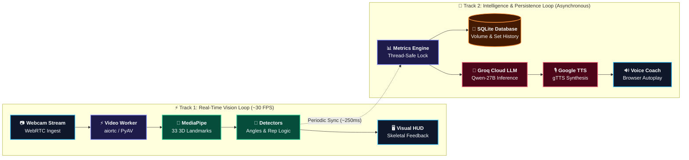
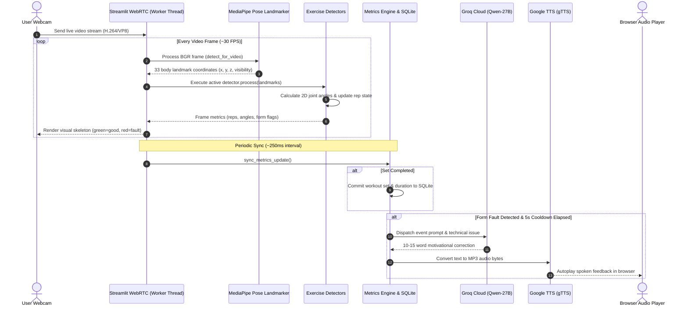

<p align="center">
  <picture>
    <source media="(prefers-color-scheme: dark)" srcset="https://shieldcn.dev/header/gradient.svg?title=GymGuru+AI&subtitle=Real-Time+Pose+Tracking+%26+Voice+Coach&theme=emerald&mode=dark" />
    
  </picture>
</p>

<p align="center">
  <a href="https://www.python.org/"></a>
  <a href="https://streamlit.io/"></a>
  <a href="https://developers.google.com/mediapipe"></a>
  <a href="https://groq.com/"></a>
  <a href="https://github.com/HariomGupta0/GymGuru_AI/stargazers"></a>
  <a href="LICENSE"></a>
</p>

---

## 📌 Overview

**GymGuru AI** is an intelligent, browser-based personal gym trainer that brings real-time exercise analysis and spoken coaching directly into your home workouts through a standard webcam. 

Using **MediaPipe Pose Landmarker** and custom biomechanical angle calculators, GymGuru AI tracks 33 body landmarks per frame, counts reps via dual-threshold hysteresis state machines, detects posture mistakes (such as sagging hips, knee caving, or torso swinging), and delivers instant, motivational voice cues powered by **Groq Cloud LLM (`qwen/qwen3.8-27b`)** and **Google Text-to-Speech (gTTS)**.

---

## 🚀 Key Features

* **Real-Time 33-Landmark Pose Tracking**: Leverages MediaPipe's high-precision model (`pose_landmarker_full.task`) to calculate multi-joint angles across the sagittal and frontal planes.
* **Proactive Spoken Voice Coaching**: Generates 10–15 word high-energy coaching cues through Groq Cloud LLM (`qwen/qwen3.8-27b`), synthesized to audio via `gTTS` with an automated 5-second cooldown debounce on active form errors.
* **Dual-Threshold Rep & Set Counting**: Eliminates bounce oscillation using hysteresis state machines that require crossing distinct inflection and extension boundaries.
* **7 Supported Exercises**: Complete biomechanical heuristics for **Squats, Push-ups, Biceps Curls, Shoulder Press, Lunges, Planks, and Jumping Jacks**.
* **Dual Workout Modes**: Choose between focused **Single Exercise** training or structured sequential **Circuit Mode** with auto-advancing queues.
* **Workout Analytics Dashboard**: Logs total volume, completed sets, and active session duration to SQLite (`data.db`), rendering interactive volume distributions and daily trend charts via Pandas and Altair.
* **Low-Latency WebRTC Streaming**: Multi-threaded video ingest using `streamlit-webrtc` with thread-safe locking (`threading.Lock`) and STUN/TURN traversal.

---

## 🏗️ System Architecture

### Dual-Track Pipeline Flowchart



### Architectural Component Specifications

| Architecture Layer | Core Technology | Primary Responsibility | Data Output / Interface |
| :--- | :--- | :--- | :--- |
| **Client Ingestion** | `streamlit-webrtc` / WebRTC | Captures live camera feed with ICE/STUN NAT traversal | H.264/VP8 video stream (~30 FPS) |
| **Pose Estimation** | MediaPipe (`pose_landmarker_full.task`) | Tracks 33 spatial body landmarks in normalized $(x, y, z)$ coordinates | 33 3D body landmark vectors |
| **Biomechanical Engine** | Vector Geometry & State Machines | Calculates joint flexion angles and manages dual-threshold rep counting | Joint angles ($\theta$), rep increments, form fault tags |
| **State Synchronization** | Thread-Safe Lock (`threading.Lock`) | Decouples video worker processing from Streamlit main thread execution | Synchronized session state metrics |
| **Data Persistence** | SQLite3 (`data.db`) & Pandas | Logs timestamped sets, completed reps, and active duration | Relational tables & visual Altair analytics |
| **Proactive Voice Coach** | Groq Cloud (`qwen/qwen3.8-27b`) | Formulates high-energy, context-aware 10–15 word voice corrections | Dynamic natural language coaching cues |
| **Speech Playback** | Google Text-to-Speech (`gTTS`) | Synthesizes coaching strings into audio with a 5s debounce cooldown | Autoplay MP3 audio in browser client |

<details>
<summary><b>🔍 View Detailed Multi-Threaded Execution Sequence Diagram</b></summary>



</details>

---

## 🏃 Biomechanical Evaluation Matrix

| Exercise | Monitored Joints & Landmarks | Computed Angles / Metrics | State Machine Thresholds | Form Mistakes Evaluated |
|---|---|---|---|---|
| **Squats** | Hips (23, 24), Knees (25, 26), Ankles (27, 28), Shoulders (11, 12) | • Knee Angle (Hip-Knee-Ankle)<br>• Torso Back Angle (Shoulder-Hip-Knee) | • **Down**: Knee $< 100^\circ$<br>• **Up**: Knee $\ge 160^\circ$ (Rep +1) | • Shallow depth (Knee $> 100^\circ$ at bottom)<br>• Excessive torso forward lean (Back $< 130^\circ$) |
| **Push-ups** | Shoulders (11, 12), Elbows (13, 14), Wrists (15, 16), Hips (23, 24), Ankles (27, 28) | • Elbow Angle (Shoulder-Elbow-Wrist)<br>• Body Angle (Shoulder-Hip-Ankle)<br>• Hip Deviation $y - \frac{y_s + y_a}{2}$ | • **Down**: Elbow $< 90^\circ$<br>• **Up**: Elbow $> 160^\circ$ (Rep +1) | • Body alignment fault (Body $\le 140^\circ$)<br>• Hip sagging (Dev $> 0.08$)<br>• Hip piking (Dev $< -0.08$) |
| **Bicep Curls** | Shoulders (11, 12), Elbows (13, 14), Wrists (15, 16), Hips (23, 24) | • Elbow Angle (Shoulder-Elbow-Wrist)<br>• Torso Angle ($\text{atan2}(\vert dx\vert, \vert dy\vert)$)<br>• Elbow Drift $\vert x_e - x_s\vert$ | • **Up**: Elbow $< 50^\circ$<br>• **Down**: Elbow $> 160^\circ$ (Rep +1) | • Elbow drifting from ribs (Drift $> 0.06$)<br>• Torso momentum cheating (Torso $> 15^\circ$) |
| **Shoulder Press** | Shoulders (11, 12), Elbows (13, 14), Wrists (15, 16), Hips (23, 24), Knees (25, 26) | • Elbow Angle (Shoulder-Elbow-Wrist)<br>• Lumbar Back Arch (Shoulder-Hip-Knee) | • **Up**: Elbow $> 160^\circ$<br>• **Down**: Elbow $< 90^\circ$ (Rep +1) | • Incomplete lockout (Elbow $< 160^\circ$)<br>• Excessive lower back arch (Back $< 140^\circ$) |
| **Lunges** | Hips (23, 24), Knees (25, 26), Ankles (27, 28), Shoulders (11, 12) | • Front Knee Angle $\min(\theta_L, \theta_R)$<br>• Lateral Offset $\vert x_{s\_mid} - x_{h\_mid}\vert$ | • **Down**: Front Knee $< 100^\circ$<br>• **Up**: Front Knee $> 160^\circ$ (Rep +1) | • Lateral instability / loss of balance (Offset $> 0.10$)<br>• Insufficient knee drop |
| **Planks** | Shoulders (11, 12), Hips (23, 24), Ankles (27, 28) | • Body Alignment Angle<br>• Vertical Hip Sag Deviation | Isometric Hold:<br>Accumulates active seconds when valid | • Body sag or pike (Hip Dev $\vert \Delta\vert > 0.08$)<br>• Body bend (Body $\le 140^\circ$) |
| **Jumping Jacks** | Shoulders (11, 12), Wrists (15, 16), Hips (23, 24), Ankles (27, 28) | • Stance Ratio $\frac{\text{Ankle Dist}}{\text{Shoulder Width}}$<br>• Vertical Wrist Clearance vs Shoulders/Hips | • **Open**: Stance $> 1.2$ & Wrists above shoulders<br>• **Closed**: Stance $< 0.9$ & Wrists below hips | • Narrow foot spread (Stance $< 1.2$)<br>• Incomplete arm raise (Wrists below shoulders) |

---

## 🛠️ Tech Stack

* **Frontend & Web Framework**: [Streamlit](https://streamlit.io/) (1.54.0), HTML5, Custom CSS, Adobe Clean typography
* **Computer Vision**: [MediaPipe](https://developers.google.com/mediapipe) (0.10.14), [OpenCV Headless](https://opencv.org/) (4.10.0)
* **Real-Time Video Ingestion**: [`streamlit-webrtc`](https://github.com/whitphx/streamlit-webrtc) (0.64.5), PyAV, WebRTC, STUN/TURN
* **AI & Intelligence**: [Groq Cloud SDK](https://console.groq.com/) (`qwen/qwen3.8-27b` model with rate-limit defensive fallbacks)
* **Speech Synthesis**: [Google Text-to-Speech (`gTTS`)](https://pypi.org/project/gTTS/) (2.5.3)
* **Persistence & Analytics**: SQLite3, [Pandas](https://pandas.pydata.org/) (2.2.3), Altair
* **Runtime & Packaging**: Python 3.12 (CPython), `python-dotenv` (1.2.2)

---

## ⚙️ Getting Started & Local Setup

### Prerequisites

> [!IMPORTANT]
> **Python 3.12 is required.** MediaPipe currently does not distribute stable Windows wheels for Python 3.13+. Please ensure you run Python 3.12.x.

### 1. Clone the Repository

```bash
git clone https://github.com/HariomGupta0/GymGuru_AI.git
cd GymGuru_AI
```

### 2. Configure Environment Variables

Copy the provided environment template to `.env`:

```bash
cp .env.example .env
```

Open `.env` and provide your Groq API key:

```env
GROQ_API_KEY=your_groq_api_key_here
```

*(You can obtain a free Groq API key at [console.groq.com/keys](https://console.groq.com/keys)).*

### 3. Create a Virtual Environment & Install Dependencies

#### Option A: Using `uv` (Fastest, ~10s)

```powershell
# Create environment explicitly targeting Python 3.12
uv venv --python "C:\Users\<username>\AppData\Local\Programs\Python\Python312\python.exe" .venv

# Install pinned dependencies
uv pip install -r requirements.txt
```

#### Option B: Using Standard Python `venv`

```powershell
# Create virtual environment with Python 3.12
py -3.12 -m venv .venv

# Activate environment
.\.venv\Scripts\Activate.ps1

# Install requirements
pip install -r requirements.txt
```

---

## 🚦 Running the Application

Launch the Streamlit web application:

```powershell
# Directly using the virtual environment:
.\.venv\Scripts\python.exe -m streamlit run main.py

# Or if your virtual environment is active:
python -m streamlit run main.py
```

Open **`http://localhost:8501`** in your browser, enter a unique username, choose your workout plan, and click **Start Session**!

---

## 🌐 WebRTC & Cloud Deployment Notes

* **Localhost Testing**: WebRTC establishes an immediate peer connection over local loopback (`127.0.0.1`), needing no external network traversal.
* **Streamlit Community Cloud**: Cloud containers block incoming UDP video ports. If deploying remotely, configure a free TURN relay server (such as [Xirsys](https://xirsys.com/) or [Metered](https://metered.ca/)) in Streamlit Cloud Secrets:

```toml
GROQ_API_KEY = "your_groq_api_key"
TURN_URL = "turn:global.relay.metered.ca:443"
TURN_USERNAME = "your_username"
TURN_PASSWORD = "your_password"
```

The application will dynamically load these credentials from `st.secrets` without exposing them in your codebase.

---

## 📂 Project Structure

```
GymGuru_AI/
├── .devcontainer/                # Container definition for GitHub Codespaces / VS Code
│   └── devcontainer.json
├── .streamlit/                   # Streamlit server and theme configuration
│   └── config.toml
├── core/                         # Shared base classes and math utilities
│   ├── __init__.py
│   └── base_exercise.py          # Vector angle math & abstract BaseExercise class
├── detectors/                    # Heuristic exercise detectors (form + rep logic)
│   ├── __init__.py
│   ├── biceps_curls.py
│   ├── jumping_jacks.py
│   ├── lunges.py
│   ├── plank.py
│   ├── pushup.py
│   ├── shoulder_press.py
│   └── squat.py
├── LandingPage/                  # Standalone promotional landing website
│   ├── fonts/                    # Averta typography assets
│   ├── IMGs_add_your_own/        # Media gallery placeholder
│   ├── videos_add_your_own/      # Video demo placeholder
│   ├── index.html
│   └── style.css
├── ml_models/                    # MediaPipe pose estimation model weights
│   ├── __init__.py
│   └── pose_landmarker_full.task
├── services/                     # Application service layer
│   ├── __init__.py
│   ├── auth/                     # Username registration & session wall
│   ├── coaching/                 # Groq LLM integration, gTTS, and voice pipeline
│   ├── config/                   # Workout schemas and system prompt templates
│   ├── persistence/              # SQLite data repository & daily upsert logic
│   ├── state/                    # Default session state initialization
│   ├── tracking/                 # Metrics synchronization & circuit sequencing
│   ├── ui/                       # Stylesheet loaders & WebRTC style injection
│   └── vision/                   # VideoProcessorClass & skeleton renderer
├── static/                       # Streamlit UI typography and styles
│   ├── AdobeClean.otf
│   └── style.css
├── .env.example                  # Sanitized environment variable template
├── .gitignore                    # Production-grade Git exclusion rules
├── LICENSE                       # MIT License
├── main.py                       # Main application entry point & dashboard
├── packages.txt                  # Linux system packages for OpenCV deployment
├── README.md                     # Project documentation
└── requirements.txt              # Pinned Python dependencies
```

---

## 📄 License

Distributed under the **MIT License**. See [`LICENSE`](LICENSE) for full details.

---

<p align="center">
  Developed by <a href="https://github.com/HariomGupta0">Hariom Gupta</a> • Built with Python, MediaPipe, Streamlit, and Groq Cloud
</p>
